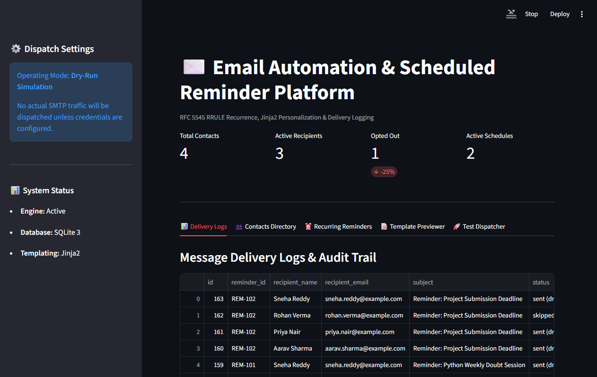
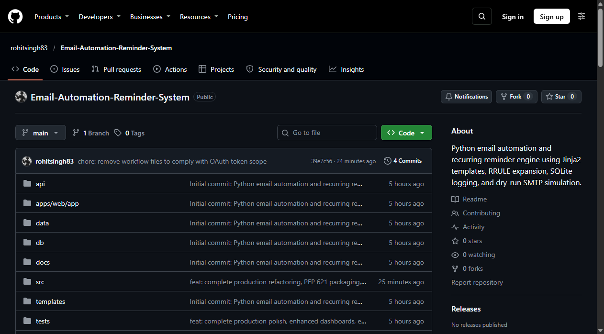

# Email Automation & Reminder System

A resilient, production-ready Python email automation engine featuring RFC 5545 `RRULE` recurring schedule expansion, dynamic Jinja2 HTML templating, compliance-first unsubscribe management, SQLite delivery audit logging, and safe dry-run simulation mode.

---

## 🏛 Architecture & Dispatch Pipeline

```
[Contacts CSV (with opt-out flags)] + [Reminders CSV (with RRULE schedules)]
                             │
                             ▼
             [RRULE Recurrence Expansion] (dateutil)
                             │
                             ▼
         [Opt-Out & Unsubscribe Compliance Check]
          ├── Unsubscribed ──► [Log Skipped Status]
          └── Active ────────► [Jinja2 Template Rendering]
                                     │
                                     ▼
                      [SMTP Dispatcher / Dry-Run Mode]
                                     │
                                     ▼
                [SQLite Delivery Log & Audit Trail]
                                     │
                                     ▼
              [CSV Dispatch Reports & FastAPI Service]
```

---

## ✨ Key Features

- **Standardized Recurrence (RRULE):** Leverages `dateutil.rrule` to support daily, weekly, monthly, and interval-based recurrence rules with count/until bounds.
- **Dynamic HTML Templating:** Powered by `Jinja2` for personalized email bodies, dates, and dynamic context variables.
- **Unsubscribe & Privacy Compliance:** Automatically checks `unsubscribed` status before rendering or queuing emails to prevent unsolicited messages.
- **Safe Dry-Run Simulation:** Allows developers and QA to test end-to-end rendering and scheduling without transmitting live emails.
- **FastAPI Tracking & Management:** Exposes RESTful endpoints (`/health`, `/logs`, `/contacts`, `/reminders`) along with tracking webhooks.
- **Full Relational Audit:** Logs every delivery attempt, timestamp, subject, and error details in SQLite (`db/email.db`).

---

## 🚀 Quick Start Guide

### 1. Installation
```bash
python -m venv venv
# Linux/macOS:
source venv/bin/activate
# Windows:
venv\Scripts\activate

pip install -r requirements.txt
cp .env.example .env
```

### 2. Run Automation Engine
```bash
# Runs in safe dry-run simulation by default
python main.py
```

### 3. Launch Streamlit Dashboard
```bash
python -m streamlit run app_streamlit.py
```

### 4. Run API Service
```bash
uvicorn api.app:app --host 0.0.0.0 --port 8000 --reload
```

### 5. Run Tests
```bash
python -m unittest discover -s tests -v
```

---

## 🔌 API Endpoints

| Method | Endpoint | Description |
|---|---|---|
| `GET` | `/health` | Service health status. |
| `GET` | `/logs` | Retreive all email delivery records from SQLite. |
| `GET` | `/contacts` | Returns list of configured contacts and unsubscribe status. |
| `GET` | `/reminders` | Returns recurring reminder definitions. |
| `GET` | `/t/o/{id}.gif` | Transparent 1x1 GIF for open-rate tracking. |
| `GET` | `/t/c/{id}` | Click-tracking redirect handler. |

<!-- project-brief-sections -->

---

## 🎯 Problem Statement

Teams send the same reminders again and again: session reminders, deadline alerts, renewal notices. Doing it by hand leads to missed emails, wrong names and no record of what was sent. This system reads contacts and reminder schedules from CSV files, personalises HTML templates, sends (or safely simulates) the emails, respects unsubscribes and logs every attempt.

## 🏭 Industry Relevance

Marketing-automation and CRM tools (Mailchimp, HubSpot, SendGrid) and internal ops teams use scheduled, templated, logged email delivery every day. The project shows Python automation, SMTP, templating, scheduling and audit logging, which are relevant to Python Developer, Automation and Backend roles.

## 🧰 Tech Stack

- Python 3.10+
- smtplib + email.mime (SMTP sending)
- Jinja2 (HTML templates)
- Pandas (CSV contacts and reminders)
- python-dateutil (recurring schedules / RRULE)
- SQLite (message logs)
- FastAPI (API + open/click webhooks), Streamlit + Plotly (dashboard)
- pytest (tests)

## 📁 Folder Structure

```
Email-Automation-Reminder-System/
├── api/
│   └── app.py
├── apps/
│   └── web/
│       └── app/
│           └── page.tsx
├── data/
│   ├── contacts.csv
│   └── reminders.csv
├── db/
│   └── schema.sql
├── docs/
│   ├── GITHUB_GUIDE.md
│   └── INTERVIEW_QA.md
├── images/
├── outputs/
│   └── email_dispatch_report.csv
├── src/
│   ├── __init__.py
│   ├── config.py
│   ├── mailer.py
│   ├── renderer.py
│   ├── scheduler.py
│   └── webhooks.py
├── templates/
│   ├── deadline_reminder.html
│   └── session_reminder.html
├── tests/
│   └── test_email.py
├── .env.example
├── .gitignore
├── app_streamlit.py
├── AUDIT.md
├── CHANGELOG.md
├── CONTRIBUTING.md
├── DECISIONS.md
├── main.py
├── PROGRESS.md
├── pyproject.toml
├── README.md
├── requirements.txt
└── run_worker.py
```

## ▶️ How to Run

```bash
pip install -r requirements.txt
python main.py   # dry-run mode by default, no real emails are sent
python -m pytest -q          # run the test suite
streamlit run app_streamlit.py  # interactive dashboard
uvicorn api.app:app --reload   # REST API at http://127.0.0.1:8000/docs
```

## 🧾 Sample Output

Terminal output of `python main.py` (generated from the sample data in `data/`):

```text
=== Email Automation & Reminder System (dry_run=True) ===
reminder_id    recipient                    email       scheduled_for                 status
    REM-101 Aarav Sharma aarav.sharma@example.com 2026-11-20 19:00:00         sent (dry-run)
    REM-101   Priya Nair   priya.nair@example.com 2026-11-20 19:00:00         sent (dry-run)
    REM-101  Rohan Verma  rohan.verma@example.com 2026-11-20 19:00:00 skipped (unsubscribed)
    REM-101  Sneha Reddy  sneha.reddy@example.com 2026-11-20 19:00:00         sent (dry-run)
    REM-101 Aarav Sharma aarav.sharma@example.com 2026-11-21 19:00:00         sent (dry-run)
    REM-101   Priya Nair   priya.nair@example.com 2026-11-21 19:00:00         sent (dry-run)
    REM-101  Rohan Verma  rohan.verma@example.com 2026-11-21 19:00:00 skipped (unsubscribed)
    REM-101  Sneha Reddy  sneha.reddy@example.com 2026-11-21 19:00:00         sent (dry-run)
    REM-102 Aarav Sharma aarav.sharma@example.com 2026-11-22 18:00:00         sent (dry-run)
    REM-102   Priya Nair   priya.nair@example.com 2026-11-22 18:00:00         sent (dry-run)
    REM-102  Rohan Verma  rohan.verma@example.com 2026-11-22 18:00:00 skipped (unsubscribed)
    REM-102  Sneha Reddy  sneha.reddy@example.com 2026-11-22 18:00:00         sent (dry-run)

Saved dispatch report to: outputs/email_dispatch_report.csv
```

Generated files (committed in `outputs/` so you can inspect them on GitHub):

- [`outputs/email_dispatch_report.csv`](outputs/email_dispatch_report.csv): Every reminder × recipient with scheduled time and status (sent / skipped / failed)

## 🖼 Screenshots

### Dashboard Preview



### Github Repo Preview



## 📚 Learning Outcomes

- Sending email from Python with SMTP and keeping credentials in a .env file
- Rendering personalised HTML emails with Jinja2 templates
- Parsing dates and expanding recurring schedules
- Handling unsubscribes, retries and failures safely
- Logging every delivery to SQLite for auditing
- Exposing logs through FastAPI and visualising them in Streamlit

## 🎤 Interview Preparation

10 frequently asked interview questions with answers, including **"Explain your project"**, are in [`docs/INTERVIEW_QA.md`](docs/INTERVIEW_QA.md). GitHub upload steps are in [`docs/GITHUB_GUIDE.md`](docs/GITHUB_GUIDE.md).
