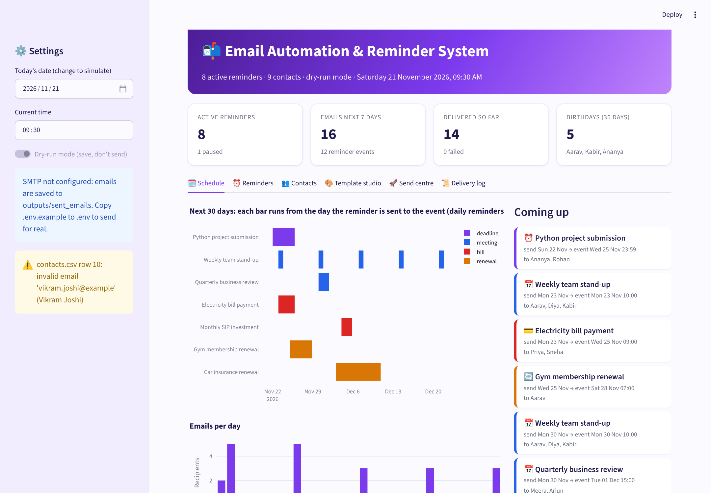
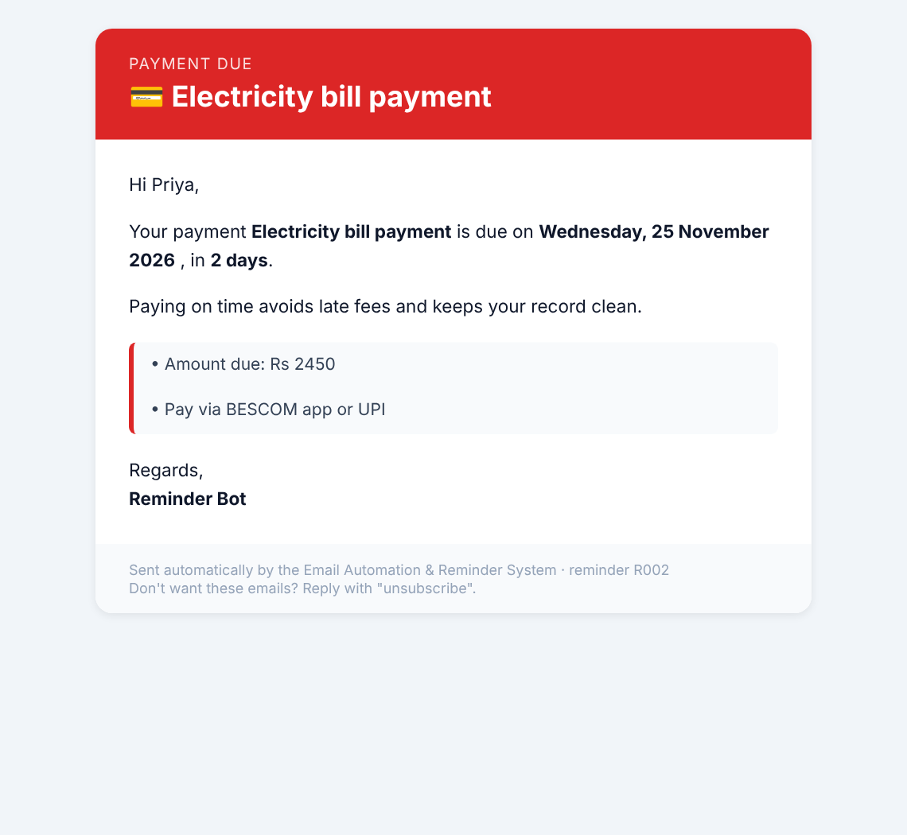
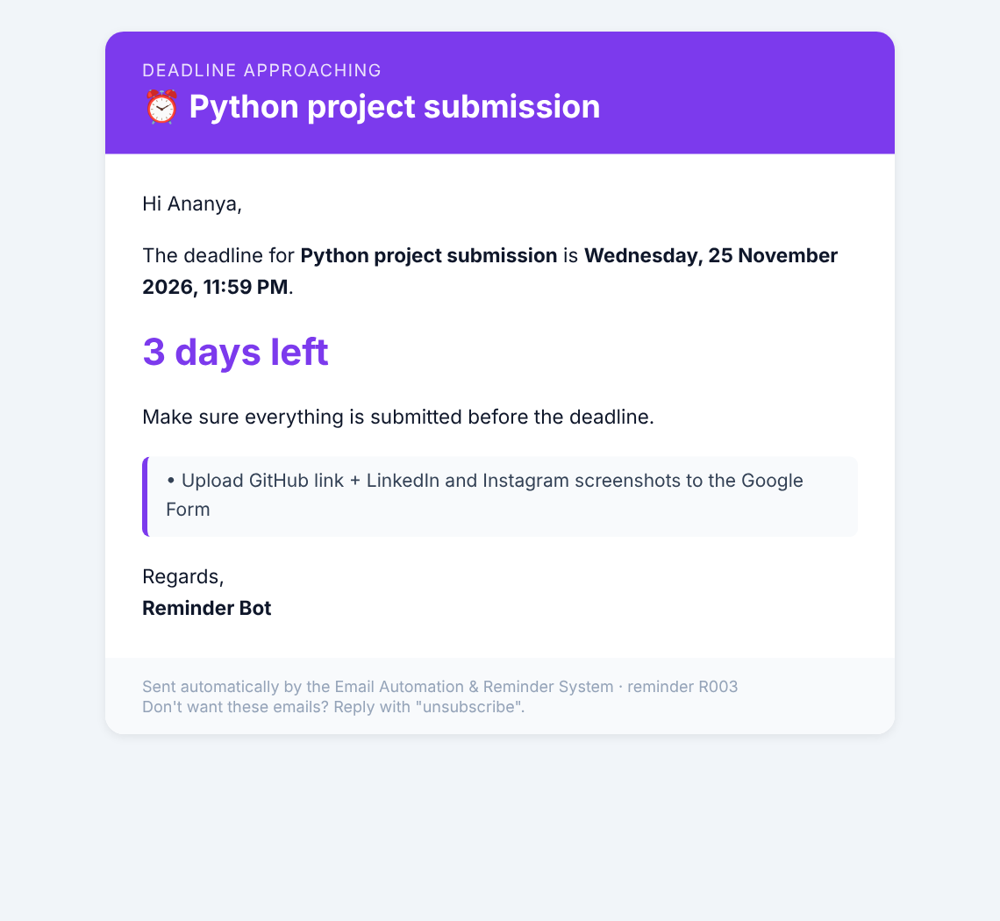
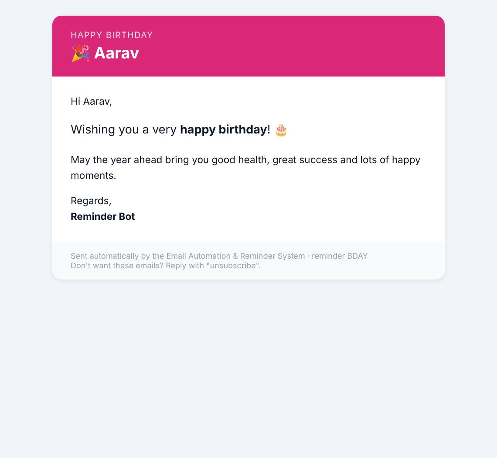
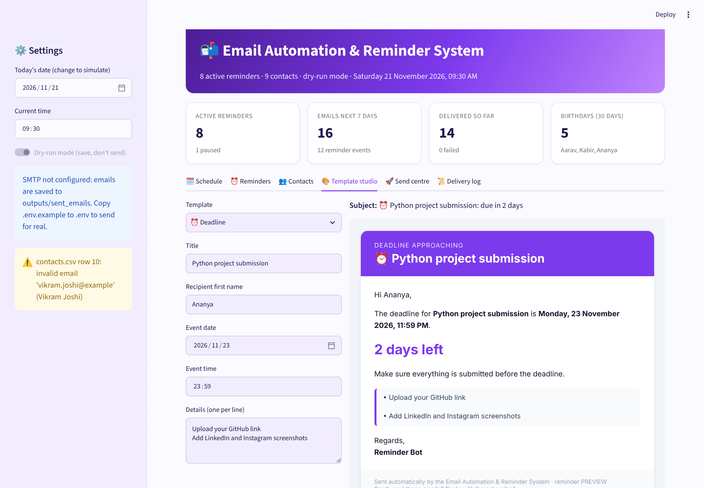
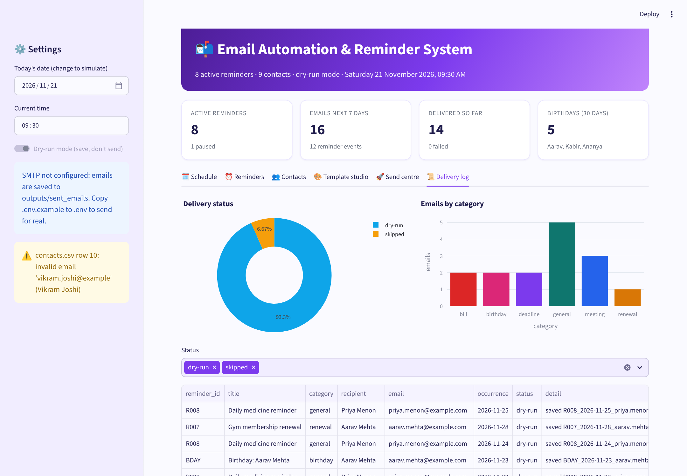
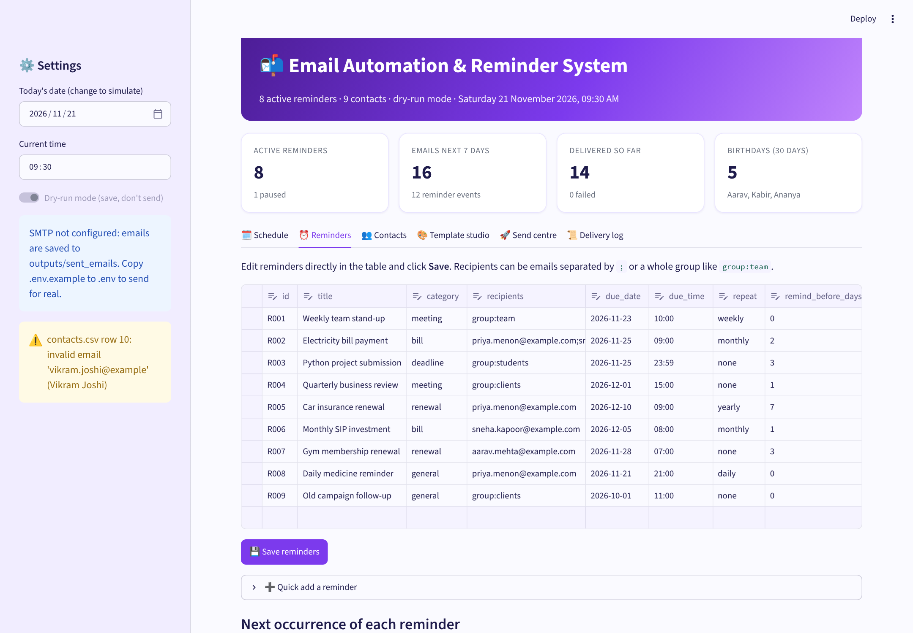
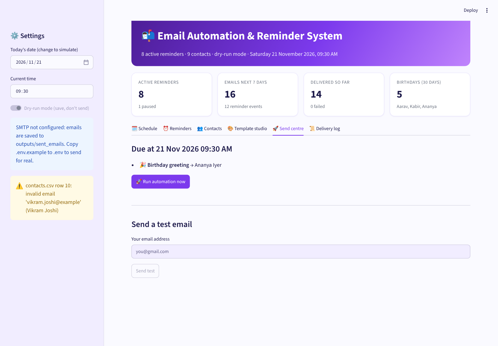

# Email Automation & Reminder System

🌐 **Live report:** https://rohitsingh83.github.io/Email-Automation-Reminder-System/ · 💻 **Source:** https://github.com/rohitsingh83/Email-Automation-Reminder-System

A Python system that sends **personalised, professionally designed reminder emails** automatically: bills,
meetings, deadlines, renewals and birthdays. It handles repeating schedules and lead times, skips unsubscribed
contacts, never sends the same reminder twice, and logs every delivery. You can use it from the command line or
through a **Streamlit control centre** with a live template editor.



---

## Problem statement

Individuals and teams constantly miss payments, renewals, meetings and deadlines because reminders depend on
someone remembering to send them. Manual emails are repetitive, error-prone (wrong names, wrong dates) and leave
no record. This project automates the whole process, from deciding *when* to send, to personalising the
message, delivering it and recording the result.

## Industry relevance

The same pattern runs inside billing systems ("your invoice is due"), HR onboarding, schools and coaching
institutes (fee and exam reminders), clinics (appointment reminders), SaaS products (renewal notices) and
marketing tools such as Mailchimp and SendGrid. It shows practical skills for **Python Developer, Automation
Engineer and Backend** roles: SMTP/MIME, templating, scheduling logic, data validation, idempotent processing
and secure credential handling.

## Features

- **5 reminder types** with their own design: 📅 meeting, 💳 bill, ⏰ deadline, 🔄 renewal, 🔔 general, plus automatic 🎉 birthday wishes
- **Repeat rules**: none, daily, weekly, monthly, yearly (31 Jan → 28/29 Feb handled correctly)
- **Lead time**: "remind me 3 days before"
- **Groups**: send to `group:team` or individual addresses
- **Responsive HTML emails** (Jinja2 template inheritance, inline CSS) with a plain-text fallback
- **Real SMTP sending** (Gmail, Outlook, any provider) with TLS/SSL and automatic retries
- **Dry-run mode** (default): emails saved as `.eml` and `.html` files to inspect safely
- **No duplicates**: the SQLite log makes re-runs safe, so it can run every 15 minutes
- **Data validation**: invalid emails and broken dates are reported, not crashed on
- **Unsubscribe support**: opted-out contacts are skipped and logged
- **Time travel for testing**: `--at "2026-11-23 10:00"` simulates any moment
- **Control centre**: schedule timeline, editable reminders and contacts, live template studio, one-click send, delivery analytics
- **16 automated tests** covering the tricky date logic

## Tech stack

| Area | Tools |
|---|---|
| Language | Python 3.10+ |
| Email | smtplib, email.message (MIME multipart), ssl |
| Templates | Jinja2 |
| Data | Pandas (CSV), SQLite (delivery log) |
| Config | python-dotenv (`.env`) |
| CLI | argparse, Rich |
| Dashboard | Streamlit, Plotly |
| Testing | pytest |

## How it works

```
contacts.csv + reminders.csv → validate → find due reminders (repeat rule + lead time)
   → expand groups → skip unsubscribed / already sent → render HTML template
   → send via SMTP (or save in dry-run) → write delivery log → dashboard / CSV report
```

Reminders with a lead time are sent at 08:00 on the send day; same-day reminders are sent one hour before the
event. Architecture and design decisions: [docs/PROJECT_EXPLANATION.md](docs/PROJECT_EXPLANATION.md).

## Folder structure

```
Email-Automation-Reminder-System/
├── data/
│   ├── contacts.csv          # name, email, group, birthday, subscribed
│   └── reminders.csv         # what, who, when, repeat, lead time, details
├── templates/                # base.html + meeting / bill / deadline / renewal / general / birthday
├── src/
│   ├── config.py             # paths and SMTP settings from .env
│   ├── data_loader.py        # load + validate CSVs, expand groups
│   ├── scheduler.py          # repeat rules, lead time, birthdays, due-now logic
│   ├── renderer.py           # Jinja2 → subject, HTML and plain text
│   ├── mailer.py             # SMTP sender with retries + dry-run sender
│   ├── log_store.py          # SQLite delivery log (duplicate protection)
│   └── engine.py             # the automation loop
├── outputs/                  # sample sent emails (.eml/.html), delivery_log.csv
├── images/                   # dashboard and email screenshots
├── docs/                     # live report (index.html, GitHub Pages), project explanation, interview Q&A
├── tests/test_reminders.py
├── main.py                   # command-line tool
├── app.py                    # Streamlit control centre
├── .env.example              # copy to .env for real sending
├── requirements.txt
└── .gitignore
```

## Installation

```bash
git clone https://github.com/rohitsingh83/Email-Automation-Reminder-System.git
cd Email-Automation-Reminder-System
```

Create and activate a virtual environment.

On Windows:

```bash
python -m venv venv
venv\Scripts\activate
```

On macOS or Linux:

```bash
python3 -m venv venv
source venv/bin/activate
```

Install the dependencies:

```bash
pip install -r requirements.txt
```

**Optional, for real sending:** copy `.env.example` to `.env` and add your Gmail address and an
[App Password](https://myaccount.google.com/apppasswords) (2-step verification must be on). Set `DRY_RUN=false`.

## How to run

See what will be sent in the next two weeks:

```bash
python main.py upcoming --days 14
```

Send everything that is due right now (dry-run by default):

```bash
python main.py run
```

Simulate another date and time:

```bash
python main.py run --at "2026-11-23 09:30"
```

Keep running and check every 15 minutes:

```bash
python main.py watch --every 15
```

Preview one reminder as HTML, export the log, or send a real test email:

```bash
python main.py preview R003
```

```bash
python main.py log
```

```bash
python main.py test-email you@gmail.com
```

Open the control centre:

```bash
streamlit run app.py
```

Run the tests:

```bash
python -m pytest -q
```

## Sample output

`python main.py run --at "2026-11-23 09:30"`:

```text
⚠ contacts.csv row 10: invalid email 'vikram.joshi@example' (Vikram Joshi)

Run at 23 Nov 2026 09:30  mode: dry-run
┏━━━━━━━━━━┳━━━━━━━━━━━━━━━━━━━━━━━━━━┳━━━━━━━━━━━━━━┳━━━━━━━━━━━━━━━━━━━━━━━━━━┳━━━━━━━━━┓
┃ Reminder ┃ Title                    ┃ Recipient    ┃ Email                    ┃ Status  ┃
┡━━━━━━━━━━╇━━━━━━━━━━━━━━━━━━━━━━━━━━╇━━━━━━━━━━━━━━╇━━━━━━━━━━━━━━━━━━━━━━━━━━╇━━━━━━━━━┩
│ R001     │ Weekly team stand-up     │ Aarav Mehta  │ aarav.mehta@example.com  │ dry-run │
│ R001     │ Weekly team stand-up     │ Diya Sharma  │ diya.sharma@example.com  │ dry-run │
│ R001     │ Weekly team stand-up     │ Kabir Singh  │ kabir.singh@example.com  │ dry-run │
│ R002     │ Electricity bill payment │ Priya Menon  │ priya.menon@example.com  │ dry-run │
│ R002     │ Electricity bill payment │ Sneha Kapoor │ sneha.kapoor@example.com │ dry-run │
│ BDAY     │ Birthday: Aarav Mehta    │ Aarav Mehta  │ aarav.mehta@example.com  │ dry-run │
└──────────┴──────────────────────────┴──────────────┴──────────────────────────┴─────────┘
Emails saved in outputs/sent_emails (open the .html files in a browser)
```

Running the same command again shows `duplicate` for every row: nothing is sent twice. Simulating 21–25 November
produced [`outputs/delivery_log.csv`](outputs/delivery_log.csv) (14 delivered, 1 skipped because the contact
unsubscribed). The generated emails are in [`outputs/sent_emails/`](outputs/sent_emails).

## Screenshots

**Emails as recipients see them**

| Bill | Deadline | Birthday |
|---|---|---|
|  |  |  |

**Control centre**

| Template studio (live preview) | Delivery log |
|---|---|
|  |  |

| Reminders (editable) | Send centre |
|---|---|
|  |  |

## Learning outcomes

- How email works: SMTP, TLS, authentication, MIME multipart messages
- Designing HTML emails that render in Gmail and Outlook
- Jinja2 templates with inheritance and conditional text
- Date arithmetic and edge cases (month ends, leap years, lead times)
- Idempotent processing with a database constraint
- Validating messy input data and failing gracefully
- Keeping secrets out of code with `.env`
- Building a CLI with sub-commands and a multi-tab Streamlit dashboard
- Testing time-dependent code by injecting the current time

## Interview preparation

14 common questions with HR and technical answers, starting with **"Explain your project"**:
[docs/INTERVIEW_QA.md](docs/INTERVIEW_QA.md)

## Disclaimer

All contacts are fictional (`example.com` addresses). Only send emails to people who have agreed to receive them.
